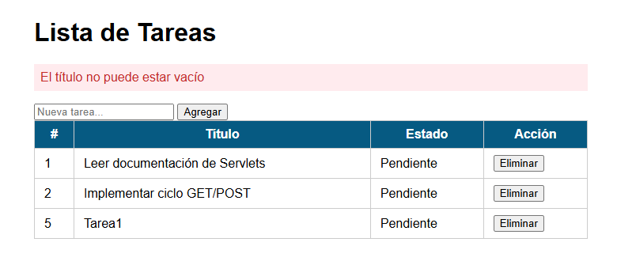
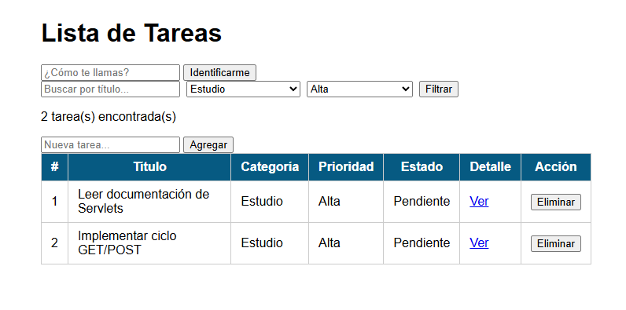
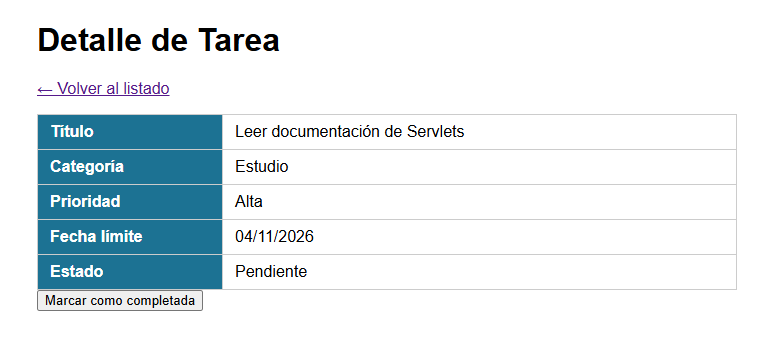

# Post-contenido — Unidad 5: Fundamentos de Java Web (Servlets y JSP)

## Descripción

Repositorio del laboratorio de la Unidad 5 de Programación Web —
Séptimo Semestre. Un único proyecto Maven Web (`gestion-tareas`) con dos
partes que extienden el mismo dominio de tareas: la Parte 1 construye
el Servlet base con el ciclo GET/POST y el patrón Post/Redirect/Get; la
Parte 2 le agrega filtrado combinado, vista de detalle con un segundo
Servlet, y sesión para personalización y persistencia del filtro.

## Parte 1 — Servlet de gestión de tareas

`TareasServlet` procesa peticiones GET (listar) y POST (agregar,
eliminar), con validación en el servidor y el patrón Post/Redirect/Get
para evitar el reenvío de formularios.

## Parte 2 — Filtros, detalle y sesión

`TareasServlet` se extiende con filtrado combinado por texto, categoría
y prioridad, y con las acciones `completar` e `identificar`. Se agrega
`DetalleTareaServlet`, que lee la misma lista de tareas desde
`applicationScope` y hace `forward` a una vista de detalle. `HttpSession`
guarda el nombre del usuario identificado y el último filtro aplicado.

## Decisiones de diseño

- **Lista de tareas como variable de instancia:** es estado compartido
  de toda la aplicación, no un dato de una petición individual. Los datos
  propios de una petición (por ejemplo el `titulo` leído en un POST) son
  variables locales del método, porque el Servlet es una sola instancia
  compartida por todos los hilos.
- **Filtro activo y nombre de usuario en `HttpSession`, no en el request:**
  deben sobrevivir a varias peticiones distintas (navegación entre
  `/tareas` y `/tareas/detalle`). La lista filtrada resultante sí vive solo
  en el request, porque es el resultado calculado para esa respuesta.
- **`DetalleTareaServlet` lee las tareas desde el `ServletContext`
  (`applicationScope`) y usa `forward`:** así no se duplica la lista y solo
  se entrega un objeto ya calculado a la vista, sin generar una nueva
  petición del navegador. El patrón PRG (`sendRedirect`) se reserva para
  las acciones POST, donde sí conviene una nueva petición GET limpia.
- **Estilos en `css/estilos.css`:** se extrajeron del bloque `<style>` de
  la Parte 1 al agregar una segunda vista (`detalle.jsp`), para no duplicar
  el CSS en cada JSP.

## Cómo compilar y desplegar

1. Clonar el repositorio:
   `git clone https://github.com/diegoalferez/Alferez-post5-u5.git`
2. Entrar a la carpeta y compilar: `mvn clean package`
   (genera `target/gestion-tareas.war`).
3. Copiar el WAR a la carpeta `webapps` de Apache Tomcat 10.1 e iniciar
   Tomcat (`bin/startup.bat`). Alternativa en IntelliJ IDEA: configurar
   un *Tomcat Server → Local* y desplegar el artefacto `war exploded`.
4. Abrir <http://localhost:8080/gestion-tareas/tareas>.

Requisitos: JDK 17+, Maven 3.8+ y Apache Tomcat 10.x (Jakarta EE).

## Capturas de pantalla

**Parte 1 — Lista de tareas (GET/POST con PRG):**

**Parte 2 — Lista con filtro combinado aplicado (categoría + prioridad):**

**Parte 2 — Detalle de una tarea:**

